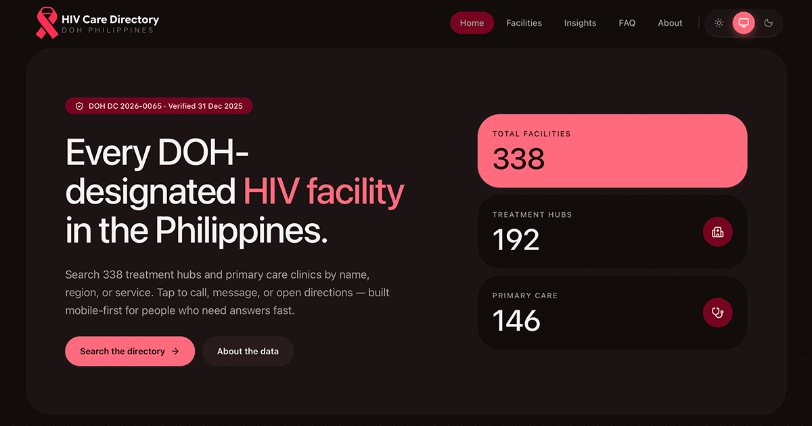

<p align="center">
  
</p>

<h1 align="center">Philippine HIV Care Directory</h1>

<p align="center">
  An independent, public-information mirror of all <strong>338 DOH-designated HIV treatment hubs and primary care facilities</strong> in the Philippines, sourced from Department Circular No. 2026-0065.
</p>

<p align="center">
  <a href="#license"></a>
  <a href="#license"></a>
  
  
</p>

---

## Overview

The Philippine HIV Care Directory is a fast, accessible, mobile-first web application that helps Filipinos locate DOH-designated HIV treatment hubs and primary care facilities offering Antiretroviral Therapy (ART), Pre-Exposure Prophylaxis (PrEP), Post-Exposure Prophylaxis (PEP), and HIV testing services across the country.

The platform exists to reduce friction between people living with or at risk of HIV and the public services already available to them. Information is mirrored faithfully from official DOH issuances and presented in a clean, searchable, shareable interface that works equally well on desktop, tablet, and entry-level mobile devices.

### Objectives

- Provide a single, authoritative directory of all 338 DOH-designated HIV facilities.
- Reduce information barriers for patients, healthcare workers, advocates, and researchers.
- Deliver a high-performance, accessible experience that meets WCAG 2.1 AA.
- Operate as a Progressive Web App so the directory remains usable on slow or intermittent networks.
- Preserve full transparency of sources and remain non-commercial.

### Key Capabilities

- Full-text search across all 338 facilities by name, region, province, and city.
- Detail pages for each facility with services, address, and contact information.
- Aggregated surveillance insights derived from public DOH data.
- Frequently Asked Questions on HIV care pathways in the Philippines.
- Installable PWA with offline support and home-screen install prompt.
- Server-rendered metadata for accurate link previews on Facebook, LinkedIn, X, iMessage, and WhatsApp.
- Light, dark, and system theme support with persistent user preference.
- Structured data (JSON-LD) for search engines and AI assistants.

---

## Technology Stack

| Layer            | Technology                                                                                                                                                             |
| ---------------- | ---------------------------------------------------------------------------------------------------------------------------------------------------------------------- |
| Framework        |  TanStack Start v1 (SSR + server functions)                                  |
| UI Library       |  React 19                                                                               |
| Language         |  TypeScript 5 (strict mode)                                               |
| Build Tool       |  Vite 7                                                                                   |
| Styling          |  Tailwind CSS v4 (native CSS `@import`)                                |
| Components       |  Radix UI primitives + shadcn/ui patterns                                           |
| Icons            |  Lucide React                                                                         |
| Data Fetching    |  TanStack Query v5                                                |
| Forms            | React Hook Form + Zod                                                                                                                                                  |
| Charts           | Recharts                                                                                                                                                               |
| PWA              |  vite-plugin-pwa + Workbox                                                                     |
| Server Runtime   |  Nitro (Vercel / Node / Cloudflare presets)                                                 |
| Package Manager  |  Bun                                                                                           |
| Hosting Targets  |  Vercel · cPanel Node · Cloudflare-compatible                                         |
| Tooling          | ESLint 9 · Prettier 3 · TypeScript ESLint                                                                                                                              |
| Fonts            | Google Sans Flex (variable, opsz 6–144, wght 100–1000)                                                                                                                 |

---

## Features

- **Facility Directory.** Browse and search every DOH-designated HIV facility, grouped by region and service type.
- **Facility Detail Pages.** Each facility has a dedicated route with services, address, and metadata optimized for sharing.
- **Insights.** Public surveillance figures presented through accessible charts.
- **FAQ.** Plain-language answers to common questions on ART, PrEP, PEP, testing, and confidentiality.
- **About.** Background on the project and its independent, non-commercial nature.
- **Installable PWA.** Add to home screen on iOS and Android; offline shell for repeat visits.
- **Theme Switching.** Light, dark, and system modes with persisted preference.
- **SEO + Social.** Per-route titles and descriptions, JSON-LD Organization and WebSite schema, absolute Open Graph image URLs.
- **Sitemap.** Auto-generated `sitemap.xml` for search engines.

---

## Mobile App

Native Android and iOS apps are maintained in a separate repository, [phdoh-hivaids-mobile](https://github.com/ramonloganjr/phdoh-hivaids-mobile) (Flutter). They mirror every public page and the admin area, work offline for the directory, and are generated from this repository's data, logo and icons. Two endpoints exist for them: `GET /api/public/impact` and `POST /api/admin/redeploy`.

---

## Architecture Overview

```text
┌──────────────────────────────────────────────────────────────┐
│                       Client (Browser)                       │
│  React 19  •  TanStack Router  •  TanStack Query  •  PWA SW  │
└───────────────▲──────────────────────────────▲───────────────┘
                │ Hydration                    │ RPC (serverFn)
┌───────────────┴──────────────────────────────┴───────────────┐
│                   TanStack Start (SSR Layer)                 │
│      Route loaders   •   createServerFn   •   API routes     │
└──────────────────────────────▲───────────────────────────────┘
                               │
                ┌──────────────┴──────────────┐
                │   Nitro Server (Vercel /    │
                │   Node / Cloudflare)        │
                └─────────────────────────────┘
```

**Project layout**

```text
src/
├── routes/              File-based routes (TanStack Router)
│   ├── __root.tsx       App shell, head metadata, providers
│   ├── index.tsx        Homepage
│   ├── facilities.tsx   Directory listing
│   ├── facilities.$id.tsx
│   ├── insights.tsx     Surveillance insights
│   ├── faq.tsx
│   ├── about.tsx
│   ├── privacy.tsx
│   ├── terms.tsx
│   └── api.og.tsx       OG image endpoint
├── components/          UI components (incl. shadcn/ui under ui/)
├── data/                Typed datasets and metadata
├── lib/                 Helpers, server functions (*.functions.ts)
├── hooks/               React hooks
├── assets/              Asset manifests (.asset.json)
└── styles.css           Tailwind v4 entry + theme tokens
public/                  Static assets served at site root
```

---

## Installation

### Prerequisites

- Node.js 24 (pinned in `package.json`)
- Bun 1.3 or newer

### Clone and install

```bash
git clone <repository-url>
cd <project-directory>
bun install
```

---

## Development Setup

Start the development server with hot module replacement:

```bash
bun run dev
```

The application is available at `http://localhost:8080`.

Useful scripts:

```bash
bun run lint        # ESLint
bun run format      # Prettier
bun run preview     # Preview the production build locally
```

---

## Build Process

The default build targets the Vercel runtime. Additional presets are available for other hosts.

```bash
bun run build           # Default build
bun run build:dev       # Development-mode build (verbose)
bun run build:vercel    # Explicit Vercel preset
bun run build:cpanel    # Node server preset for cPanel / VPS
```

Build artifacts are written to `dist/`. The Vercel preset outputs a `.vercel/output` directory consumed by the Vercel build system. The Node preset emits `dist/server/index.mjs`, started in production with:

```bash
bun run start:cpanel
```

---

## Deployment

### Vercel

1. Import the repository in the Vercel dashboard.
2. Framework preset: **Other**. Build command: `bun run build` (or leave default). Output: managed by Nitro.
3. Trigger a deploy. Subsequent pushes deploy automatically.

### cPanel / Node VPS

1. Build locally or on the server: `bun run build:cpanel`.
2. Upload `dist/` and `package.json`.
3. Configure the Node app entry point to `dist/server/index.mjs`.
4. Start with `bun run start:cpanel` or your process manager (PM2, systemd).

See `DEPLOY-CPANEL.md` for the complete cPanel walkthrough.

---

## Configuration

Runtime configuration uses environment variables. Two scopes apply:

| Scope        | Prefix              | Example                            |
| ------------ | ------------------- | ---------------------------------- |
| Client/build | `VITE_*`            | `VITE_PUBLIC_SITE_URL`             |
| Server only  | `process.env.*`     | secrets used inside server handlers |

Client variables are bundled at build time and visible to end users. Never place secrets in `VITE_*` variables.

---

## Accessibility Compliance

The project targets **WCAG 2.1 Level AA**.

- Semantic HTML with a single `h1` per route and correct heading hierarchy.
- Skip-to-main-content link on every page.
- Keyboard-navigable Radix UI primitives with visible focus rings.
- Color tokens validated for 4.5:1 minimum contrast in both light and dark themes.
- `prefers-reduced-motion` respected in animations.
- `aria-*` attributes on icon-only controls.
- Form fields associated with labels via React Hook Form.
- Images use descriptive `alt` text; decorative images use `alt=""`.
- Touch targets sized to at least 44×44 CSS pixels.

---

## PWA Capabilities

- Web app manifest at `/manifest.webmanifest` with maskable icons.
- Service worker registered only in production and never inside iframes.
- Offline application shell via Workbox.
- Add-to-home-screen prompt on supported platforms.
- iOS standalone meta tags (`apple-mobile-web-app-*`).
- Theme color synchronized with brand primary `#FF2E51`.
- Safe service worker unregister via `?sw=off`.

---

## SEO and Social

- Per-route titles (under 60 characters) and meta descriptions (under 160 characters).
- Absolute `og:image`, `og:image:secure_url`, and `twitter:image` URLs resolved server-side at request time, ensuring valid previews on Facebook, LinkedIn, X, iMessage, and WhatsApp.
- JSON-LD `Organization` and `WebSite` schemas, including `SearchAction`.
- `robots.txt` and dynamic `sitemap.xml`.
- Canonical metadata on each route.

---

## Changelog

### June 2026 (later) — Five-module audit: correctness, security, realtime

End-to-end pass across **Near Me**, **Impact**, **Sign-In**, **Admin Dashboard**, and **Feedback**. Priority order: correctness & security first, then realtime, then UX gaps.

**Auth & session hygiene**
- New `signOutCleanly` helper (`src/lib/sign-out.ts`) cancels in-flight queries and clears the TanStack Query cache before `supabase.auth.signOut()` — eliminates the 401 storm and prevents the back button from rendering a protected shell hydrated from stale cache.
- Global `onAuthStateChange` listener in `src/routes/__root.tsx` keeps multi-tab sessions in sync.
- `/auth` now accepts a Zod-validated `redirect` search param (same-site paths only) so users return to their previous page after sign-in.

**Realtime synchronization**
- New `useRealtimeInvalidate` hook (`src/hooks/use-realtime-invalidate.ts`) — debounced (800 ms) postgres_changes subscription that invalidates a React Query key on any insert/update/delete. Channels are per-page and torn down on unmount.
- Migration: `REPLICA IDENTITY FULL` on `testimonials` and `metric_events`, both added to the `supabase_realtime` publication. **`feedback` deliberately excluded** — anonymous subscribers could otherwise tail the moderation queue.
- Wired live updates + a "Live" status badge into `/impact` (published testimonials) and `/admin/insights` (metric events).

**Feedback reliability**
- `Turnstile` widget now accepts a `resetSignal` prop and auto-resets after submission failure (Cloudflare tokens are single-use), so users can retry without a page refresh.
- Feedback form trims input and guards against double-submit.

**Verified clean**
- Supabase linter: no new warnings.
- Security scan: no new findings; deferred items unchanged.
- Realtime publication audited — no sensitive tables exposed.

### June 2026 — Branding, theming, and enterprise audit pass

**Branding and metadata**
- Fixed manifest `name` duplication ("Philippine HIV Care Philippines" → "HIV Care Philippines"); same fix applied to `<title>`, `og:image:alt`, and `og:site_name`.
- Unified favicon source — single pointer in `manifest.webmanifest`, no CDN drift.
- Added swapping header logo (light/dark) to `/auth`.
- Split `<meta name="theme-color">` into `media`-scoped light (`#FFF5F6`) and dark (`#1A0E11`) variants for iOS Safari.

**Theming and accessibility**
- Replaced `text-white` in `theme-toggle.tsx` with `text-primary-foreground` (token compliance).
- Fixed `@custom-variant dark` selector to match both `html.dark` and descendants (`&:where(.dark, .dark *)`).
- Lifted light-mode `--on-surface-muted` from `0.48` to `0.44` for WCAG-AA-safe secondary text (~5.3:1 contrast).

**Reliability**
- Hardened `getPublicImpact` server function with `Promise.allSettled` and an `emptyImpact()` fallback so the `/impact` page degrades gracefully when the backend is unreachable.
- Replaced default Recharts tooltips with a Material-styled `ChartTip` across `/insights` (PieChart + three BarCharts).
- Switched router `defaultPreload` from `"intent"` to `"viewport"` to eliminate a TanStack Router hover-race console error.

**Security**
- Added per-IP token-bucket rate limiting to `/api/public/metrics/ingest` (30 events/minute, hashed IPs, in-memory).
- Documented two warn-level findings deferred to integration-managed files (`auth-middleware.ts`, `_authenticated/route.tsx`).

**Verified clean**
- Dependency scan: no high/critical vulnerabilities.
- SEO scan: zero failing findings.
- Accessibility: all icon buttons labeled, single `<main>` per page, semantic tokens throughout.

---


## Data Sources

All facility data is mirrored from the Philippine **Department of Health Department Circular No. 2026-0065**. The project is independent and non-commercial. No personally identifiable patient information is collected, stored, or transmitted.

---

## Browser Support

- Chrome, Edge, Brave, Opera — last 2 versions.
- Safari 16+ (macOS, iOS, iPadOS).
- Firefox — last 2 versions.
- Android WebView 100+.

---

## Author

Created and maintained by [Ramon Logan Jr.](https://ramonloganjr.com)

---

## License

Copyright © 2026 Ramon Logan Jr. This project is dual-licensed; the complete terms are in [`LICENSE`](./LICENSE).

| Scope                                                                                        | License                                                                                                    |
| -------------------------------------------------------------------------------------------- | ---------------------------------------------------------------------------------------------------------- |
| Source code                                                                                  | [MIT License](./LICENSE)                                                                                   |
| Documentation, editorial copy, visual design, and data presentations authored by the project | [Creative Commons Attribution 4.0 International (CC BY 4.0)](https://creativecommons.org/licenses/by/4.0/) |

- **Attribution.** When you redistribute, fork, or build on this project, retain the copyright notice and credit Ramon Logan Jr. as set out in [`LICENSE`](./LICENSE).
- **Third-party data.** Facility data is mirrored from DOH Department Circular No. 2026-0065 and remains the intellectual property of the Republic of the Philippines and the Department of Health. The project claims no ownership of it and presents it for public-information purposes only.

---

## Contributing

Contributions are welcome, particularly bug fixes, accessibility and performance improvements, documentation, and facility data corrections backed by an official source. Because people rely on this directory to find HIV care, accuracy and privacy take priority over new features.

### Reporting Issues

Search [existing issues](https://github.com/ramonloganjr/phdoh-hivaids-facility-directory/issues) first, then open a new one with the details below.

- **Bugs:** steps to reproduce, expected and actual behavior, the affected URL, your browser, OS, and device, and any screenshots or console errors.
- **Data corrections:** the facility, the incorrect field, and the official DOH issuance (department circular, memorandum, or LGU advisory) that supports the change. Facility data is never changed without a verifiable source.
- **Security vulnerabilities:** do not open a public issue. Report them privately as described in [SECURITY.md](./SECURITY.md).

### Proposing Enhancements

Open an issue before writing code for a new feature, refactor, or design change. Describe the problem, who it helps, and the proposed approach, and note any effect on accessibility, offline (PWA) behavior, SEO metadata, the Supabase schema, or the [mobile app](#mobile-app), which consumes this repository's data and API.

### Development Setup

Requires Node.js 24 (pinned in `package.json` to match production) and Bun 1.3 or newer.

```bash
bun install    # Installs from the committed bun.lock
bun run dev    # Starts the dev server at http://localhost:8080
```

- The committed `.env` contains only the public Supabase URL and publishable key. Server-only secrets (`SUPABASE_SERVICE_ROLE_KEY`, `TURNSTILE_SECRET_KEY`, `VERCEL_DEPLOY_HOOK_URL`) belong in your local environment or the Vercel project settings, never in the repository or a `VITE_*` variable.
- `bunfig.toml` skips package versions published less than 24 hours ago. Add dependencies with `bun add` and commit the updated `bun.lock`.

### Where Changes Belong

| Change                               | Location                               | Convention                                                                                                                              |
| ------------------------------------ | -------------------------------------- | --------------------------------------------------------------------------------------------------------------------------------------- |
| Pages and URLs                       | `src/routes/`                          | File-based routing; `__root.tsx` is the only app shell. `src/routeTree.gen.ts` is generated: commit it, never edit it.                  |
| Admin pages                          | `src/routes/_authenticated/`           | Protected by the layout route, which redirects signed-out users to `/auth`.                                                             |
| Server logic called from the UI      | `src/lib/*.functions.ts`               | `createServerFn`, with every input checked by `.inputValidator()`.                                                                      |
| Server-only modules                  | `*.server.ts`                          | Never imported by client code; the build's import protection enforces this.                                                             |
| HTTP endpoints                       | `src/routes/api/`                      | Server route handlers. Keep `/api/public/*` responses backward compatible for the mobile app.                                           |
| Facility, FAQ, and surveillance data | `src/data/`                            | Typed datasets. Refresh coordinates with `bun run scripts/geocode-facilities.ts`.                                                       |
| Database schema                      | `supabase/migrations/`                 | Add a new timestamped migration, enable Row Level Security with explicit policies, and regenerate `src/integrations/supabase/types.ts`. |
| UI primitives and theme              | `src/components/ui/`, `src/styles.css` | shadcn/ui on Radix. Extend the semantic tokens rather than adding raw colors.                                                           |

### Coding Standards

- **TypeScript:** strict mode; avoid `any`.
- **Styling:** semantic Tailwind tokens (`bg-surface`, `text-on-surface`), never raw color classes such as `bg-white`.
- **Accessibility:** WCAG 2.1 AA, including keyboard access with visible focus, labeled controls, 4.5:1 text contrast, `prefers-reduced-motion` support, and touch targets of at least 44×44 px.
- **Metadata:** every route sets its own title (under 60 characters), description (under 160 characters), and absolute Open Graph image URL.
- **Copy:** user-facing text follows the [voice and tone guide](./docs/voice-and-tone.md), with no emojis or em dashes.
- **Privacy:** never log, store, or send personal or health information to third parties.

### Quality Checks

Run these before opening a pull request:

```bash
bun run lint            # ESLint, including Prettier formatting
bunx tsc --noEmit       # Type check
bun run build           # Production build (Node server preset locally)
bun run start:cpanel    # Serves the build at http://localhost:3000
bun run verify:meta     # In a second terminal: titles, Open Graph tags, canonical URLs, JSON-LD
```

There is no automated test suite yet, so also check your change in desktop Chrome and Safari, iOS Safari, and Android Chrome, in light and dark themes, and using only the keyboard.

### Submitting Pull Requests

1. Branch from `main` (for example, `fix/near-me-location-prompt`) and limit each pull request to one logical change.
2. Write commit messages in the imperative mood, such as `Add region filter to facilities page`.
3. In the description, explain what changed and why, link the related issue, list the checks you ran, and include light and dark screenshots for UI changes.
4. Vercel builds a preview deployment for each pull request; builds for pull requests from forks wait for maintainer approval. Review the preview before requesting a review.
5. Every merge to `main` deploys to production at [hivcareph.org](https://hivcareph.org), so `main` must always be releasable.

By contributing, you agree that your contribution is licensed under the project's dual license described above. Conduct expectations are set out in [CONTRIBUTING.md](./CONTRIBUTING.md).

---

## Security

See [SECURITY.md](./SECURITY.md) for the responsible disclosure policy and supported versions.
